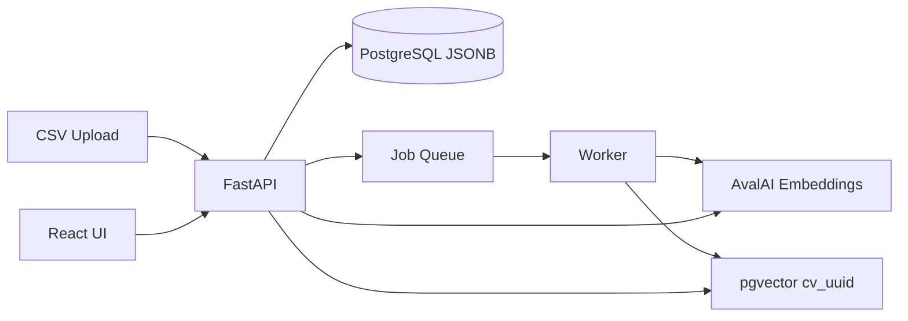

# Semantic Search Engine

**AI-Powered Semantic Search & Information Retrieval**

پلتفرم جست‌وجوی معنایی روی دادهٔ جدولی (CSV): آپلود، Embedding، ذخیرهٔ بردار در PostgreSQL/pgvector، و بازیابی بر اساس شباهت معنایی — نه فقط تطابق کلیدواژه.

| | |
|---|---|
| مخزن | [github.com/PMwithAlix/Semantic-Search](https://github.com/PMwithAlix/Semantic-Search) |
| راه‌اندازی عملیاتی | همین فایل، بخش نصب |
| محصول | [docs/PRODUCT_OVERVIEW.md](./docs/PRODUCT_OVERVIEW.md) |
| معماری | [docs/ARCHITECTURE.md](./docs/ARCHITECTURE.md) |
| قابلیت‌ها | [docs/FEATURES.md](./docs/FEATURES.md) |

---

## ۱. معرفی پروژه

### Semantic Search چیست؟

جست‌وجوی معنایی Query و اسناد را به بردار عددی (Embedding) تبدیل می‌کند و نزدیک‌ترین مفاهیم را پیدا می‌کند. لازم نیست واژه‌های Query عیناً در متن باشند.

### این پروژه چه مسئله‌ای را حل می‌کند؟

تیم‌ها معمولاً دانش خود را در CSV دارند: تیکت پشتیبانی، شرح محصول، یا رکورد عملیاتی. جست‌وجوی Excel/SQL روی کلمه شکست می‌خورد وقتی کاربر «پول کم شده سفارش نیست» می‌نویسد و سند می‌گوید «مبلغ کسر شد اما سفارش ایجاد نشد».

این مخزن یک **پلتفرم Generic** است: هر CSV با ستون‌های دلخواه آپلود می‌شود، ستون‌های متنی انتخاب می‌شوند، مدل Embedding از کاتالوگ AvalAI اعمال می‌شود، و Collection برداری برای جست‌وجو آماده می‌گردد.

### تفاوت با Keyword Search

| جست‌وجوی سنتی | این سیستم |
|----------------|-----------|
| تطابق رشته / LIKE / Full-text ساده | Cosine Similarity روی بردار Embedding |
| وابسته به واژگان مشترک | وابسته به نزدیکی معنایی مدل |
| یک ایندکس متنی | یک Collection به‌ازای ترکیب dataset + مدل + ستون‌ها |

نمونهٔ دمو در `samples/customer_support_tickets_200.csv` همین شکاف را نشان می‌دهد.

---

## ۲. مسئله و فرصت محصول

در پشتیبانی، تحقیق و عملیات، بازیابی «موارد شبیه این» مهم‌تر از پیدا کردن یک کلمهٔ دقیق است. مدل‌های Embedding این شباهت را کمی می‌کنند؛ Vector Index امکان Top-K سریع می‌دهد.

فرصت این محصول، بسته‌بندی همان ایده در یک مسیر قابل دمو برای Product و مهندسی است: از فایل خام تا نتیجهٔ رتبه‌بندی‌شده با امتیاز ۰ تا ۱، فیلتر ستون، و (در صورت وجود مختصات) نمایش روی نقشه.

محدودهٔ واقعی محصول **بازیابی اطلاعات روی ردیف‌های CSV** است، نه موتور وب و نه چت‌بات RAG.

---

## ۳. کاربران هدف

تحلیل کامل‌تر: [docs/PRODUCT_OVERVIEW.md](./docs/PRODUCT_OVERVIEW.md).

- **توسعه‌دهندگان:** API و Worker جدا، Docker، abstraction برای provider و vector store.
- **تحلیلگران داده:** UI برای آپلود، جاب، جست‌وجو و فیلتر بدون نوشتن SQL برداری.
- **تحقیق و NLP:** کاتالوگ چند مدل Embedding و اسکریپت‌های ارزیابی در `samples/`.
- **کسب‌وکار دارای پایگاه دانش جدولی:** بازیابی تیکت/سند مشابه از CSV.
- **تیم‌های AI:** مشاهدهٔ pipeline واقعی Embedding → pgvector → ranking.

برای دادهٔ مخابراتی نمونه، UI و لایهٔ intent فیلدهایی مثل کشور مبدأ/مقصد را بهتر نشان می‌دهند؛ برای تیکت پشتیبانی، ارزش اصلی همان شباهت متنی است.

---

## ۴. ارزش پیشنهادی

یک مسیر end-to-end قابل اجرا روی ماشین محلی که جست‌وجوی معنایی را از «مفهوم اسلاید» به «سیستم با API و UI» تبدیل می‌کند. مزیت نسبت به grep/SQL: درک paraphrase؛ مزیت نسبت به نوت‌بوک پژوهشی: صف جاب، Collection جدا، تنظیمات امن توکن، و رابط کاربری.

---

## ۵. قابلیت‌ها

فقط موارد تأییدشده از کد در «پیاده‌سازی‌شده» آمده‌اند. فهرست دقیق: [docs/FEATURES.md](./docs/FEATURES.md).

**پیاده‌سازی‌شده:** آپلود/Import CSV؛ انتخاب مدل و ستون؛ Embedding ناهمزمان با resume؛ جست‌وجوی Cosine؛ فیلتر متادیتا با چند عملگر؛ intent محدود از Query؛ متریک زمان؛ تنظیمات توکن رمزنگاری‌شده؛ UI دوزبانه؛ نقشه در صورت مختصات معتبر.

**ناقص / محدود:** intent دامنه-خاص (عمدتاً CDR)؛ بدون Auth؛ یک Worker؛ ارزیابی کیفیت داخل محصول نیست؛ نام نمایشی UI هنوز VectorForge است.

**برنامه‌ریزی‌شده از روی abstraction:** provider غیر AvalAI، Vector DB دیگر، قالب متن قابل پیکربندی، چند Worker، هویت کاربری.

---

## ۶. معماری فنی

جزئیات: [docs/ARCHITECTURE.md](./docs/ARCHITECTURE.md).



جریان داده: فایل در `uploads/` ذخیره می‌شود → ردیف‌ها JSONB می‌شوند → متن Embedding از ستون‌های انتخاب‌شده ساخته می‌شود → بردار در جدول اختصاصی Collection نوشته می‌شود → Query با همان `model_id` embed می‌شود → `1 - cosine_distance` رتبه می‌دهد.

---

## ۷. تکنولوژی‌ها

| لایه | فناوری واقعی |
|------|----------------|
| Frontend | React 18، TypeScript، Vite 5، Tailwind، Radix/shadcn، Leaflet |
| Backend | Python 3.12، FastAPI، SQLAlchemy 2، Alembic، httpx، Pydantic v2 |
| داده و بردار | PostgreSQL 16، pgvector، Cosine (`<=>`) |
| Embedding | AvalAI API (مدل‌ها از `embedding_models.json`؛ از جمله text-embedding-v3/v4، Cohere، Gemini، OpenAI-compatible و غیره) |
| اجرا | Docker Compose، Uvicorn؛ frontend با npm |
| امنیت توکن | cryptography Fernet |

`pytest` برای تست واحد موجود است اما در `requirements.txt` اعلام نشده است.

---

## ۸. ساختار پوشه‌ها

```text
semantic-search/
├── README.md
├── docs/                      # مستندات محصول و معماری
├── backend/                   # FastAPI + Worker
│   ├── app/api/routes/
│   ├── app/services/
│   ├── app/repositories/
│   ├── app/providers/embedding/
│   ├── app/worker/
│   ├── alembic/
│   └── tests/
├── project/                   # UI (Vite React)
├── samples/                   # دیتاست دمو، query تست، اسکریپت ارزیابی
├── uploads/                   # CSV آپلودشده (gitignored)
├── embedding_models.json
├── docker-compose.yml
├── .env.example
└── run.bat                    # میانبر اجرا در Windows
```

---

## ۹. نصب و راه‌اندازی

### پیش‌نیاز

- Docker Desktop
- Node.js 20+
- کلید AvalAI از [api.avalai.ir](https://api.avalai.ir)

### پیکربندی

```bash
cp .env.example .env
```

حداقل `SETTINGS_ENCRYPTION_KEY` را به یک رشتهٔ تصادفی طولانی تغییر دهید. `AVALAI_API_KEY` اختیاری است اگر بعداً از صفحهٔ Settings در UI وارد شود. فایل `.env` را commit نکنید.

متغیرهای اصلی (مطابق `backend/app/config.py` و `.env.example`):

| متغیر | پیش‌فرض | نقش |
|--------|----------|------|
| `AVALAI_API_KEY` | خالی | کلید fallback |
| `SETTINGS_ENCRYPTION_KEY` | مقدار نمونه | کلید Fernet |
| `DATABASE_URL` | postgres محلی | در Compose با سرویس `db` جایگزین می‌شود |
| `MAX_UPLOAD_SIZE_MB` | ۱۰۰ | سقف حجم آپلود |
| `EMBEDDING_BATCH_SIZE` | ۱۰ | تعداد متن در هر درخواست |
| `WORKER_POLL_INTERVAL_SECONDS` | ۲ | فاصلهٔ poll ورکر |

### اجرا با Docker + UI محلی

```bash
docker compose up --build
```

در ترمینال دیگر:

```bash
cd project
npm install
npm run dev
```

| سرویس | آدرس |
|--------|------|
| Frontend | http://localhost:5173 |
| Swagger API | http://localhost:8000/docs |
| PostgreSQL | localhost:5432 |

در Windows می‌توان `run.bat` را اجرا کرد (Compose + `npm run dev` + باز کردن مرورگر).

توقف backend: `docker compose down`.

---

## ۱۰. نمونه استفاده

۱. در Settings کلید AvalAI را ذخیره کنید.  
۲. از `samples/customer_support_tickets_200.csv` آپلود و سپس Import کنید.  
۳. در تنظیم Embedding ستونی مثل `title` و `description` و مدلی از کاتالوگ را انتخاب و جاب را تا `ready` دنبال کنید.  
۴. در Search همان Collection را انتخاب کنید.

مثال Query دمو (معنا نزدیک است، واژگان یکی نیستند):

- Query: «پول از حسابم کم شده ولی سفارش ثبت نشده»
- انتظار معنایی: تیکت‌هایی دربارهٔ کسر مبلغ بدون ثبت سفارش (مثلاً T-021 در دیتاست نمونه)

جست‌وجوی HTTP:

```http
POST /api/search
Content-Type: application/json

{
  "collection_id": "<uuid-collection-ready>",
  "query": "پول از حسابم کم شده ولی سفارش ثبت نشده",
  "top_k": 10,
  "threshold": 0.0
}
```

فایل Queryهای ارزیابی: `samples/semantic_search_test_queries.csv`.

---

## ۱۱. محدودیت‌ها

- فقط CSV؛ سقف حجم پیش‌فرض ۱۰۰MB.
- فقط provider AvalAI در runtime.
- بدون ورود کاربر / سطح دسترسی.
- یک جاب همزمان.
- Intent خودکار دامنه-محدود است و ممکن است برای CSVهای دیگر فیلتر اشتباه یا هیچ فیلتری نسازد.
- کیفیت بازیابی به مدل انتخاب‌شده و ستون‌های Embedding بستگی دارد؛ متریک رسمی داخل اپ وجود ندارد.
- دادهٔ آپلودشده و کلید API محلی‌اند؛ آن‌ها را در Git قرار ندهید.

---

## ۱۲. چشم‌انداز محصول

مسیر محصولی محتمل (متمایز از قابلیت امروز): چند منبع داده، ارزیابی کیفیت در UI، هویت و فضای کاری، و تعویض واقعی Vector DB/Provider. این موارد در abstraction آماده شده‌اند ولی تحویل نشده‌اند.

---

## ۱۳. مشارکت در توسعه

1. Issue یا توضیح تغییر را مشخص کنید؛ منطق جست‌وجو را بدون ضرورت عوض نکنید.
2. Backend: از دایرکتوری `backend` با `PYTHONPATH` مناسب تست واحد را اجرا کنید.
3. Frontend: `npm run typecheck` در `project/`.
4. Secret، `.env` و فایل‌های `uploads/` را commit نکنید.
5. پیام commit را واضح و محدود به همان تغییر نگه دارید.

تست موجود:

```bash
cd backend
pip install -r requirements.txt pytest
python -m pytest tests -q
```
