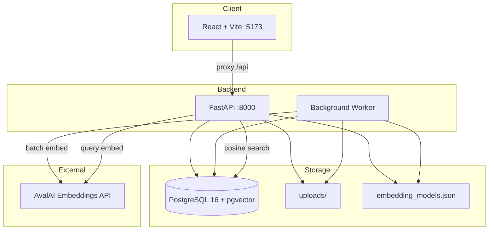

# معماری فنی

مخاطب: تیم فنی. راه‌اندازی در [README](../README.md). محصول در [PRODUCT_OVERVIEW.md](./PRODUCT_OVERVIEW.md).

## نمای کلی

پلتفرم سه سرویس دارد: UI (Vite/React)، API (FastAPI)، Worker پس‌زمینه. ذخیرهٔ ساخت‌یافته و بردارها هر دو در PostgreSQL 16 با افزونهٔ pgvector است. Embedding از API خارجی AvalAI (`https://api.avalai.ir/v1/embeddings`) گرفته می‌شود.

## لایه‌های Backend

| لایه | مسیر | نقش |
|------|------|-----|
| Routes | `backend/app/api/routes/` | HTTP |
| Services | `backend/app/services/` | قوانین کسب‌وکار |
| Vector repository | `backend/app/repositories/vector_store.py` | DDL و جست‌وجوی pgvector |
| Embedding provider | `backend/app/providers/embedding/` | کلاینت AvalAI + factory |
| Worker | `backend/app/worker/processor.py` | Import و Embedding |
| Models | `backend/app/models/entities.py` | SQLAlchemy |

## داده

- `datasets` / `dataset_columns` / `dataset_rows` (JSONB)
- `collections`: ترکیب dataset + `model_id` + ستون‌های انتخاب‌شده + `vector_table_name`
- `jobs`: import یا embedding، با `is_active` برای صف تک‌نخی
- `encrypted_settings`: توکن و تنظیمات حساس
- جدول بردار per collection: `cv_{uuid بدون خط تیره}` با ستون `embedding vector(N)`

ابعاد بردار در اولین پاسخ موفق API ست می‌شود. مدل‌های با dimension متفاوت جدول جدا دارند.

## Embedding

متن هر ردیف: مقادیر غیرخالی ستون‌های انتخاب‌شده، جداشده با `\n`.

درخواست:

`POST {AVALAI_BASE_URL}/embeddings` با `Authorization: Bearer` و `{"model", "input": [...]}`.

پیش‌فرض batch size برابر ۱۰ است (`EMBEDDING_BATCH_SIZE`)؛ محدودیت شناخته‌شدهٔ برخی مدل‌های AvalAI.

Retry: تا `EMBEDDING_MAX_RETRIES` با backoff `2 ** attempt`.

اولویت کلید: مقدار ذخیره‌شده در Settings UI (Fernet) سپس `AVALAI_API_KEY`.

## بازیابی و رتبه‌بندی

عملگر فاصلهٔ pgvector: `<=>` (cosine distance).

امتیاز برگشتی: `1 - (embedding <=> query_vec)` در بازهٔ تقریبی ۰ تا ۱.

مرتب‌سازی: فاصلهٔ کمتر اول، سپس `LIMIT top_k`.

اگر فیلتر دستی یا intent اعمال شود، آستانهٔ Cosine برای آن جست‌وجو صفر می‌شود تا فیلتر سخت‌گیرانه اولویت داشته باشد. اگر هیچ ردیفی با فیلتر جور نباشد، بدون فراخوانی Embedding لیست خالی برمی‌گردد.

Intent از regex روی Query برای چند کشور و علت برقراری تماس استنتاج می‌شود و با فیلتر دستی روی همان فیلد override می‌شود.

## API

پایه: `http://localhost:8000/api` — مستندات تعاملی: `/docs`

| Method | Path |
|--------|------|
| GET/PUT/DELETE | `/settings/status`, `/settings/token`, `/settings/general` |
| GET | `/models/embeddings` |
| GET/POST/DELETE | `/datasets`, `/datasets/upload`, `/datasets/import-jobs`, `/datasets/{id}` |
| GET/POST | `/jobs`, `/jobs/embedding` |
| GET | `/collections`, `/collections/{id}` |
| POST | `/search` |

احراز هویت کاربر وجود ندارد.

## Frontend

React 18، TypeScript، Vite (پروکسی `/api` → `:8000`)، Tailwind و کامپوننت‌های shadcn/Radix. وضعیت از `AppContext` و کلاینت `src/lib/api.ts`. مسیریابی صفحه‌ای بدون React Router.

## استقرار توسعه

`docker-compose.yml`: `db` (pgvector/pgvector:pg16)، `api` (منتظر DB، سپس `alembic upgrade head`، سپس uvicorn)، `worker` (poll هر ۲ ثانیه). Frontend بیرون از Compose با `npm run dev`. اسکریپت Windows: `run.bat`.
